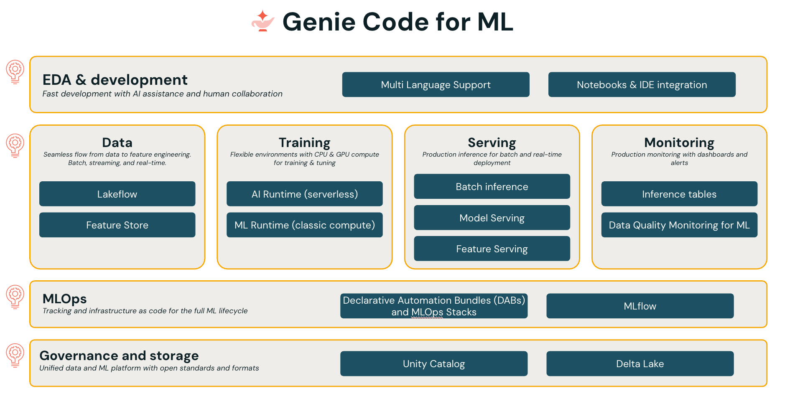
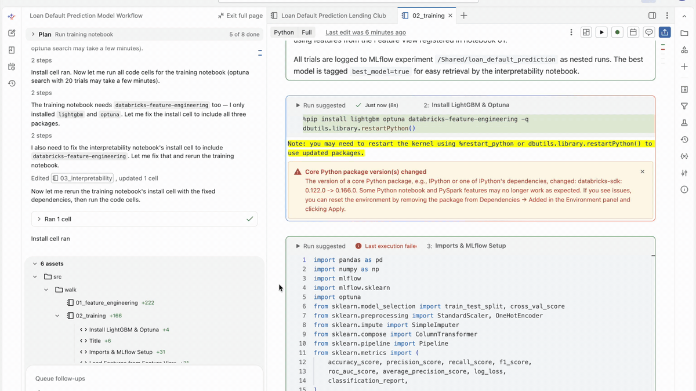

# Crawl, Walk, Run with Genie Code for ML

Companion code for the blog post [Crawl, Walk and Run with Genie Code for ML](#). Demonstrates using Databricks Genie Code to build a complete ML system from raw data to monitored production endpoint with a few example prompts. These prompts are meant to show the breadth of activity achievable with Genie Code. To achieve optimal results, scope out the problem with your coding agent!



## What's here

```
prompts/          # The exact prompts typed into Genie Code at each stage
src/
  crawl/          # Single notebook: data → label engineering → 3 trained models
  walk/           # 5 notebooks: Feature Views, Optuna tuning, SHAP, deployment, inference
  run/            # DAB config + monitoring notebook
```

## Dataset

Lending Club loan data (available in any Databricks workspace):

```
/Volumes/samples/databricks/datasets/lending-club-loan-stats/LoanStats_2018Q2.csv
```

130,776 loans, 145 columns. Task: binary classification predicting loan default.

<p align="center">
  
</p>

## Prerequisites

- A Databricks workspace with Unity Catalog enabled
- Access to a catalog for writing tables (the code uses `stablebox_catalog` — update the `CATALOG` variable in each notebook to your own)
- Serverless compute (or any cluster with the Databricks Runtime ML)

## How to run

### Crawl

Open `src/crawl/lending_club_crawl` and run all cells. Produces three models logged to MLflow.

### Walk

Run the walk notebooks in order:

1. `src/walk/01_feature_engineering` — writes a Feature View
2. `src/walk/02_training` — 50-trial Optuna sweep, logs best model to MLflow
3. `src/walk/03_interpretability` — SHAP explanations logged as MLflow artifacts
4. `src/walk/04_deployment` — registers model to UC, creates a serving endpoint
5. `src/walk/05_sample_inference` — hits the endpoint with sample loans

### Run

Deploy the automation bundle:

```bash
cd src/run
databricks bundle deploy --target dev
databricks bundle run lending_club_retrain
```

This runs all walk notebooks as a scheduled job with a monitoring step that sets up Data Quality Monitoring for drift detection.

## The prompts

The `prompts/` folder contains the exact prompts used at each stage. Note that these prompts are pedagogical and intended to show the breadth of what can be done with Genie Code. Genie Code's knowledge of Databricks best practices can produce production-quality ML code without manual authoring but you should still READ WHAT IT WRITES. Think of Genie as your personal (and very determined) ML Engineer, not an omniscient deity.

## License

This code is provided as-is for educational purposes. The Lending Club dataset is publicly available and present by default in Databricks workspaces under the `samples` catalog.
